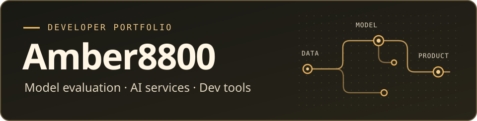
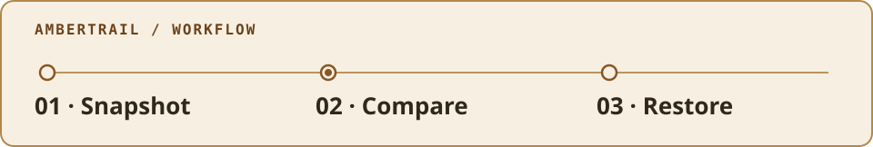

Python으로 모델을 학습하고 평가합니다. 검증한 결과를 서비스나 개발 도구에서 쓸 수 있게 만드는 일을 합니다.

## 대표작 · AmberTrail

**커밋 사이의 작업을 기록하는 VS Code 확장**

작업 중간 상태를 스냅샷으로 남깁니다. 타임라인에서 파일 변경점을 비교하고, 필요한 시점으로 되돌리거나 선택한 작업을 Git 커밋으로 정리할 수 있습니다.

**[저장소 ↗](https://github.com/Amber8800/AmberTrail)** · **[VS Code Marketplace ↗](https://marketplace.visualstudio.com/items?itemName=amber8800.dev-snapshot)**

## 팀 프로젝트

| 프로젝트 | 직접 맡은 작업 |
| :-- | :-- |
| **[창업ON](https://github.com/SKNETWORKS-FAMILY-AICAMP/SKN34-4th-3Team)** 창업 정책·세무 Q&A | RAG 검색 방식을 비교·평가하고, 사업계획서 PDF 출력과 AWS 배포를 맡았습니다. [검색 평가](https://github.com/SKNETWORKS-FAMILY-AICAMP/SKN34-4th-3Team/blob/main/Docs/reports/ELASTICSEARCH_REPORT/RETRIEVER_FINAL_REPORT.md) · [PDF 개선 PR](https://github.com/SKNETWORKS-FAMILY-AICAMP/SKN34-4th-3Team/pull/13) |
| **[VISHUE](https://github.com/gyuniverse-hq/SKN34-Final-Project)** 피부 분석·화장품 추천 | 피부 이미지 분류 모델을 학습하고, 같은 데이터 분할에서 손실 함수와 최적화 방법을 비교했습니다. 피부 고민별 추천 로직도 개발하고 있습니다. [모델 평가 PR](https://github.com/gyuniverse-hq/SKN34-Final-Project/pull/190) |
| **[Doeep](https://github.com/SKNETWORKS-FAMILY-AICAMP/SKN34-2nd-6Team)** 정기후원자 이탈 예측 | 팀 PM을 맡았고 XGBoost 모델을 후원자 데이터 일괄 예측 기능에 연결했습니다. [모델 연결 커밋](https://github.com/SKNETWORKS-FAMILY-AICAMP/SKN34-2nd-6Team/commit/def21df0cb23b01ae848930eb38b9d541a4cee53) |

**사용 기술**　`Python` · `PyTorch` · `LangGraph` · `PostgreSQL / pgvector` · `Docker / AWS`
