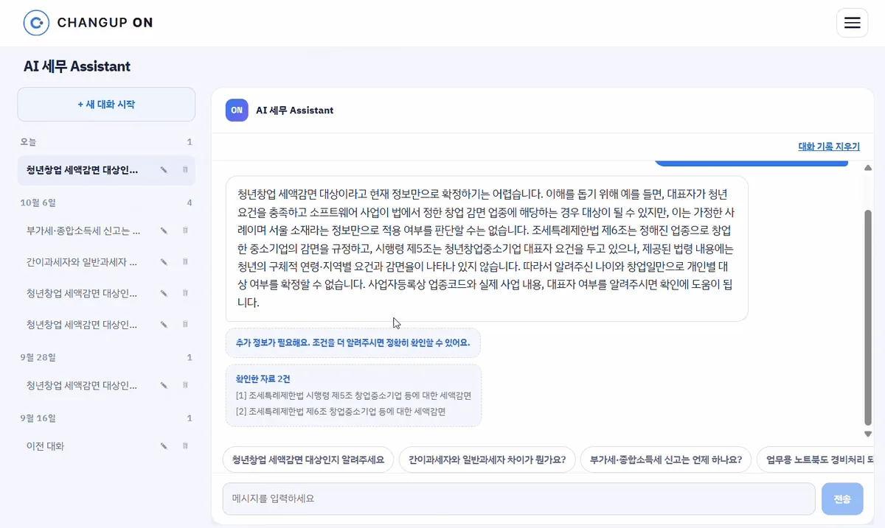

## 기술 스택

**모델링**  
  

**RAG · 백엔드**  
  

**배포**  
 

## 대표작 · 창업ON

창업 정책과 세무 질문에 답하고 사업계획서 작성을 돕는 팀 프로젝트입니다. 저는 **RAG 검색 비교·평가**, **사업계획서 PDF 출력**, **AWS 배포**를 맡았습니다.

프로젝트 저장소의 팀 시연 화면입니다. 클릭하면 원본 GIF를 볼 수 있어요.

[서비스 코드](https://github.com/SKNETWORKS-FAMILY-AICAMP/SKN34-4th-3Team) · [검색 평가 보고서](https://github.com/SKNETWORKS-FAMILY-AICAMP/SKN34-4th-3Team/blob/main/Docs/reports/ELASTICSEARCH_REPORT/RETRIEVER_FINAL_REPORT.md) · [PDF 출력 개선 PR](https://github.com/SKNETWORKS-FAMILY-AICAMP/SKN34-4th-3Team/pull/13)

## 다른 팀 프로젝트

- **[VISHUE](https://github.com/gyuniverse-hq/SKN34-Final-Project) · 피부 분석과 화장품 추천**  
  피부 이미지 분류 모델을 학습하고, 같은 데이터 분할에서 손실 함수와 최적화 방법을 비교했습니다. [학습 조건·비교 결과 보기](https://github.com/gyuniverse-hq/SKN34-Final-Project/blob/05ab63d4bb0d2bba7cb5777f3956c6e0381cbcfe/reports/skin-analysis/03-today-results.md#L26)
- **[Doeep](https://github.com/SKNETWORKS-FAMILY-AICAMP/SKN34-2nd-6Team) · 정기후원자 이탈 예측**  
  팀 PM을 맡고, XGBoost 모델을 후원자 데이터 일괄 예측 기능에 연결했습니다. [모델 연동 커밋 보기](https://github.com/SKNETWORKS-FAMILY-AICAMP/SKN34-2nd-6Team/commit/def21df0cb23b01ae848930eb38b9d541a4cee53)

## 개인 프로젝트 · AmberTrail

에이전트와 작업하다 보면 커밋 사이의 변경이 묻힐 때가 있어, 디스크에 저장된 상태를 작업 타임라인으로 남기는 VS Code 확장을 만들었습니다. 기록을 훑어보고 파일 변경을 비교하거나 필요한 시점으로 복원할 수 있습니다.

[저장소](https://github.com/Amber8800/AmberTrail) · [VS Code Marketplace](https://marketplace.visualstudio.com/items?itemName=amber8800.dev-snapshot)
